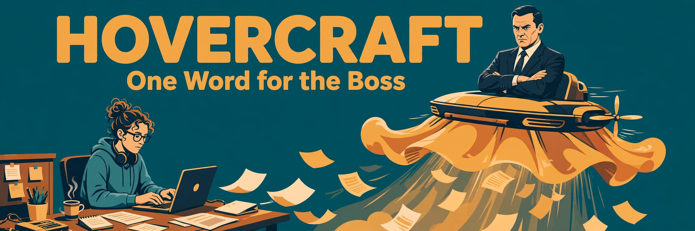
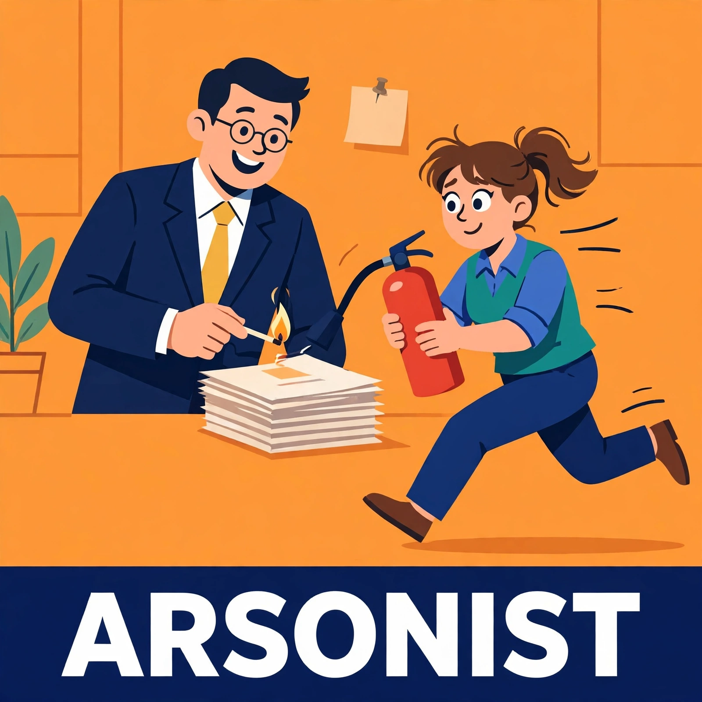
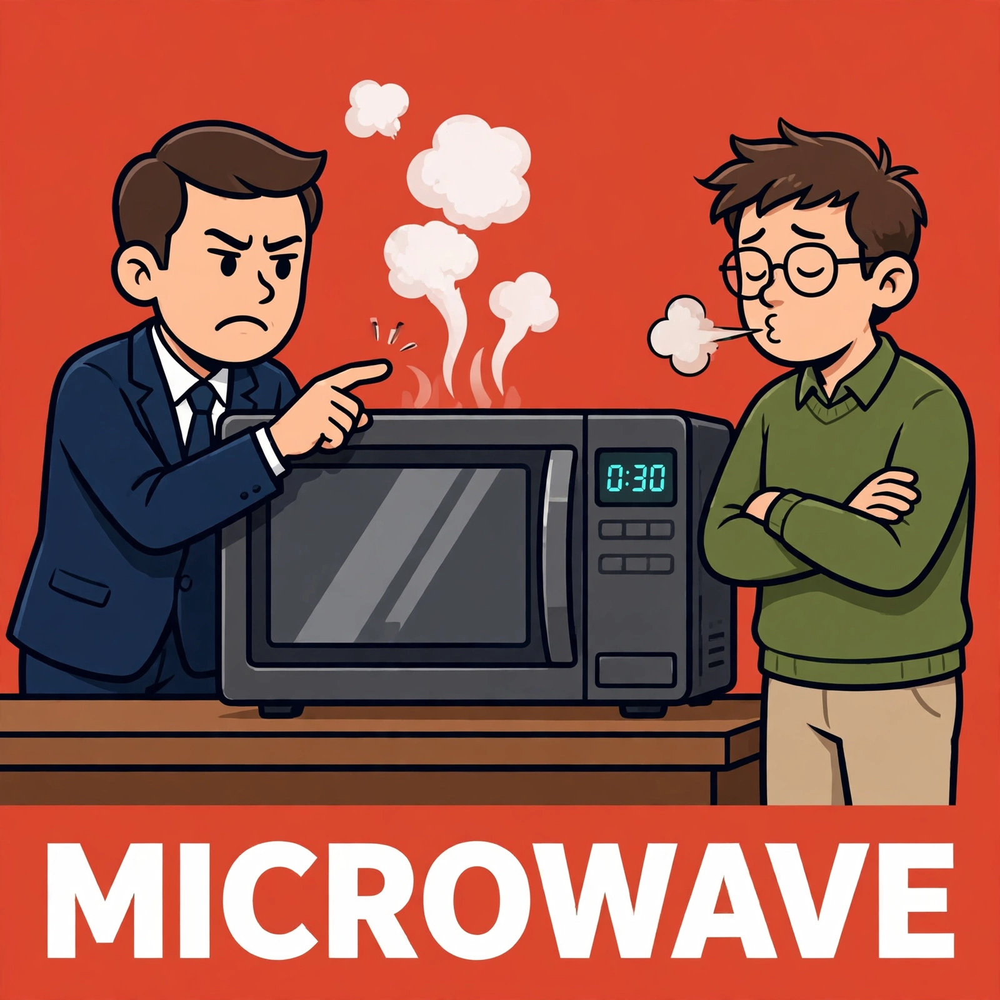

# Hovercraft — One Word for the Boss

[](https://make.fun/competitions/u-swift-badger-44-one-word-for-the-boss-6b48c735)
[](https://make.fun/competitions/u-swift-badger-44-one-word-for-the-boss-6b48c735)
[](https://make.fun/competitions/u-swift-badger-44-one-word-for-the-boss-6b48c735)



**The entry is one word: `Hovercraft`.** Ten characters, no caption, no explanation — it lands on its own.

Every office has one: the boss who doesn't walk up to your desk, but *hovers* over it — reading your screen, breathing on your shoulder, floating there until you feel the air move. In a kitchen, a warehouse, or an office, everybody knows that hover. One word, and the whole room nods.

## At a glance

| | |
|---|---|
| **Entry word** | `Hovercraft` (10 characters) |
| **Bounty** | One Word for the Boss — `u-swift-badger-44-one-word-for-the-boss-6b48c735` |
| **Prize** | $2, winner-take-all (1 place) |
| **Deadline** | 28 Nov 2026, 18:55 WIB |
| **Method** | 34 candidates, 5-criterion knockout, 24/25 |
| **Entrypoint** | `main.py` (pure Python stdlib) |
| **Gate** | `entry.txt`: UTF-8, 1–30 chars, single word, no trailing newline |
| **Test** | `python3 -P -s main.py` ×2 — byte-identical output, gate PASS |

## How it works

`main.py` writes the tournament-winning word to `$MAKEFUN_OUTPUT_DIR/entry.txt` (fallback `/output`, then `./output`), byte-exact with no trailing newline. Before writing, a self-check enforces the sealed gate: 1–30 characters, UTF-8, a single word with no spaces and no leading/trailing whitespace. After writing, it reads the file back and verifies the bytes match. Pure standard library — nothing to install, nothing imported that the grader image might lack.

```sh
python3 -P -s main.py
cat "$MAKEFUN_OUTPUT_DIR/entry.txt"   # Hovercraft
```

## How the word was chosen

The judge brief is the spec: one word describing a boss, weighed in this order — (1) a word a person would actually use about their boss, (2) funny on its own, (3) rings true about a real boss habit, (4) fresh, (5) travels across industries. 34 candidates were drafted across distinct devices (meeting habits, micromanagers, credit-takers, jargon bosses, crisis-makers, animals, objects, time), each scored 1–5 per criterion, then the top 8 fought a knockout — first differing criterion decides, per the brief. Full scores and every bout are in [`candidates.md`](candidates.md).

| Round | Bout | Result |
|---|---|---|
| QF1 | Hovercraft vs Movinggoalpost | Hovercraft — funnier on its own |
| SF1 | Hovercraft vs Creditcard | Hovercraft — the laugh is instant, no pun to complete |
| Final | Hovercraft vs Arsonist | **Hovercraft, margin 1** — the hover is literal, and it carries zero shock-risk |

Why the obvious words lose: *Micromanager*, *Ghost*, *Rockstar*, *Hurricane* score perfectly on truth and then die on freshness — in a field where everyone submits the first word they reach for, freshness is the separator. *Seagull* has the best joke in the list and the worst freshness: the judge has read that joke a thousand times.

## Finalists

| Arsonist — runner-up | Creditcard — semi-finalist | Microwave — quarter-finalist |
|---|---|---|
|  |  |  |
| Starts the fire, then expects you to fight it. Lost the final on a hair: its truth is metaphorical, Hovercraft's is literal. | Takes all the credit — the pun is inside the word. Lost the semi: its laugh needs half a beat to complete. | Wants everything in 30 seconds. Beat Echo in the quarter-final, then lost the semi to Arsonist on truth. |

## Files

| File | What it is |
|---|---|
| `main.py` | Entrypoint — writes `entry.txt` (stdlib only, gate self-check + read-back verify) |
| `candidates.md` | All 34 candidates, per-criterion scores, full knockout bracket |
| `assets/hero-hovercraft.webp` | Hero cover — the boss, literally hovering |
| `assets/card-arsonist.webp` | Finalist card — Arsonist |
| `assets/card-creditcard.webp` | Finalist card — Creditcard |
| `assets/card-microwave.webp` | Finalist card — Microwave |
| `LICENSE` | MIT |

## License

MIT — see [LICENSE](LICENSE).

---

Built for [make.fun](https://make.fun) — entry for the [One Word for the Boss](https://make.fun/competitions/u-swift-badger-44-one-word-for-the-boss-6b48c735) bounty.
